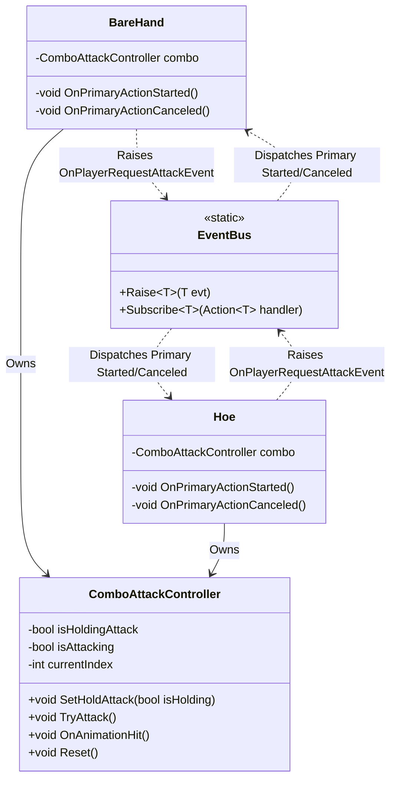

# Continuous Attack System (Bare Hand & Hoe) — Technical Architecture Plan

## 1. System Overview & GameDesign Alignment
- **Feature Name**: Continuous Attack System (Bare Hand & Hoe)
- **Target Subsystem**: Combat & Tool Interaction
- **GameOverview Reference**: Section 3.2 (Combat & Equipment), Section 2 (The Living Harvest)
- **Summary & Interview Decisions**:
  - Adds hold-to-attack capabilities to Bare Hand and Hoe so players do not have to spam Left Click when battling awakened crop monsters.
  - **Bare Hand**: Holding Left Click cycles seamlessly through punches (Punch 1 $\rightarrow$ Punch 2 $\rightarrow$ Punch 1 $\rightarrow$ Punch 2...).
  - **Hoe**: When in Combat/Idle mode, holding Left Click cycles seamlessly through the 3-hit hoe combo (Swing 1 $\rightarrow$ Swing 2 $\rightarrow$ Swing 3 $\rightarrow$ Swing 1...). Farming/Tilling mode is unaffected.
  - **Mobility**: Full movement freedom (WASD) is preserved while holding continuous attacks.

## 2. Architecture & Class Diagram

## 3. Data Models & ScriptableObjects
- Uses existing `ItemAttackData` on `Item` ScriptableObjects (`Bare Hand.asset`, `Hoe.asset`).
- No data schema changes required.

## 4. EventBus & Event Signatures
Utilizes existing events in `Assets/Project/Scripts/EventBus.cs`:
- `OnPrimaryActionStartedEvent`
- `OnPrimaryActionCanceledEvent`
- `OnPlayerRequestAttackEvent`

## 5. Implementation Task Index
| Task ID | Task Title | Target Path | Dependencies |
| :--- | :--- | :--- | :--- |
| **Task 01** | Add Hold-Attack Support to ComboAttackController | `.agent/ai-docs/tasks/continuous-attack/task-01-combo-controller.md` | None |
| **Task 02** | Implement Continuous Attack in BareHand | `.agent/ai-docs/tasks/continuous-attack/task-02-bare-hand.md` | Task 01 |
| **Task 03** | Implement Continuous Attack in Hoe Combat Mode | `.agent/ai-docs/tasks/continuous-attack/task-03-hoe-attack.md` | Task 01 |
