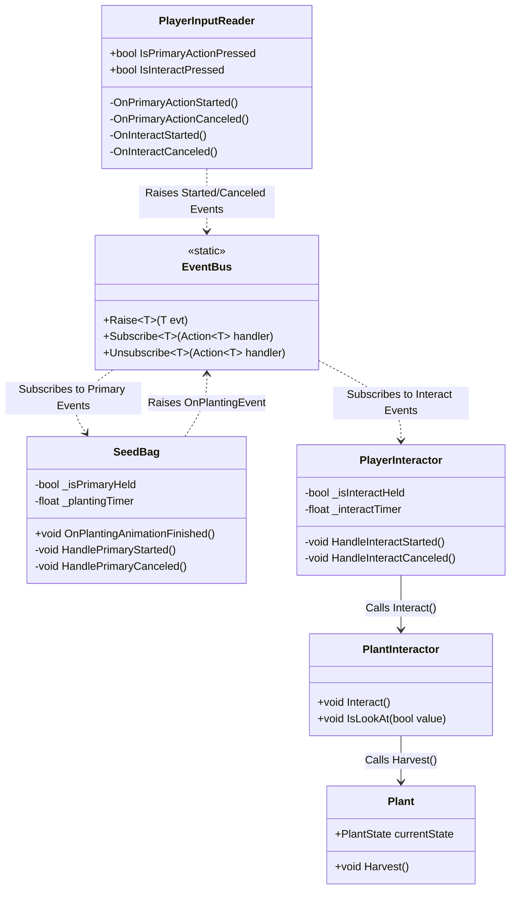

# Continuous Planting and Harvesting — Technical Architecture Plan

## 1. System Overview & GameDesign Alignment
- **Feature Name**: Continuous Click-and-Hold Planting & Harvesting System
- **Target Subsystem**: Farming & Player Interaction
- **GameOverview Reference**: Section 3.1 (Farming & Agriculture), Section 2 (The Living Harvest)
- **Summary & Interview Decisions**:
  - Replaces tedious single-click spamming with fluid click-and-hold interactions on large farm plots.
  - **Planting**: Player holds Left Mouse Button (`Primary Action`) with a `Seed Bag` equipped to continuously plant seeds while the sowing animation loops. Releasing LMB cleanly transitions back to Idle.
  - **Harvesting**: Player holds `E` (`Interact`) to automatically collect or awaken mature/withered crops targeted by the crosshair with a fast interval (~0.15s).
  - **Unity CLI**: Headless command-line utility `-executeMethod BanRaiValley.EditorCLI.VerifyProject` to validate compilation and project integrity.

## 2. Architecture & Class Diagram

## 3. Data Models & ScriptableObjects
- No changes to existing ScriptableObjects (`PlantData`, `ToolData`, `Item`).
- Uses existing `PlantStageData` and `PlantState` models.

## 4. EventBus & Event Signatures
New events added to `Assets/Project/Scripts/EventBus.cs`:
- `OnPrimaryActionStartedEvent` (`struct`, implements `IEvent`): Dispatched when primary action button begins hold.
- `OnPrimaryActionCanceledEvent` (`struct`, implements `IEvent`): Dispatched when primary action button is released.
- `OnInteractActionStartedEvent` (`struct`, implements `IEvent`): Dispatched when interact key begins hold.
- `OnInteractActionCanceledEvent` (`struct`, implements `IEvent`): Dispatched when interact key is released.

## 5. Public APIs & Interfaces
- `PlayerInputReader.IsPrimaryActionPressed`: `bool` getter.
- `PlayerInputReader.IsInteractPressed`: `bool` getter.
- `BanRaiValley.EditorCLI.VerifyProject()`: Static method for Unity batchmode command-line verification.

## 6. Implementation Task Index
| Task ID | Task Title | Target Path | Dependencies |
| :--- | :--- | :--- | :--- |
| **Task 01** | EventBus Signals & PlayerInputReader Hold Tracking | `.agent/ai-docs/tasks/continuous-planting-harvesting/task-01-input-events.md` | None |
| **Task 02** | Continuous Harvesting in PlayerInteractor | `.agent/ai-docs/tasks/continuous-planting-harvesting/task-02-continuous-harvest.md` | Task 01 |
| **Task 03** | Continuous Planting & Sowing Animation Loop in SeedBag | `.agent/ai-docs/tasks/continuous-planting-harvesting/task-03-continuous-planting.md` | Task 01 |
| **Task 04** | Unity CLI Editor Validation Utility | `.agent/ai-docs/tasks/continuous-planting-harvesting/task-04-unity-cli.md` | Tasks 01–03 |
