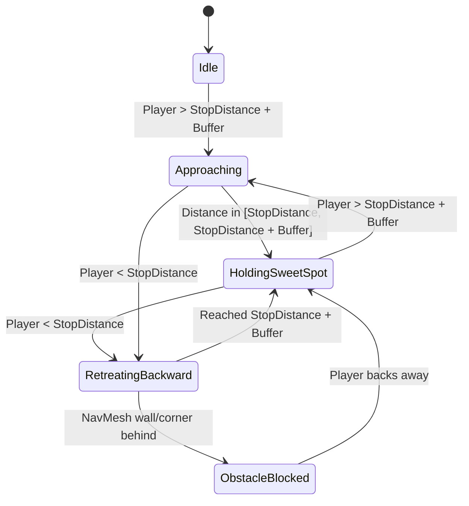
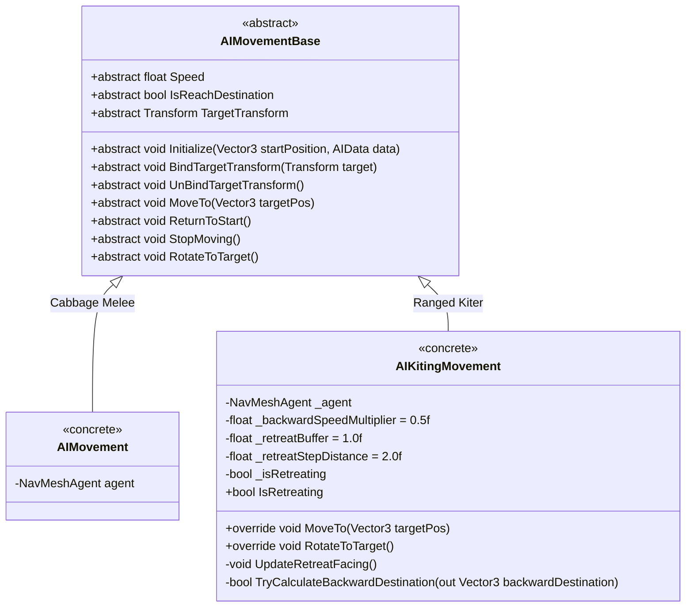

# Kiting & Ranged Movement System (`AIKitingMovement`) — Technical Architecture Plan

## 1. System Overview & GameDesign Alignment
- **Feature Name**: Kiting & Ranged Backward Movement (`AIKitingMovement`)
- **Target Subsystem**: Plant AI Locomotion (`Assets/Project/Scripts/AI/`)
- **GameOverview Reference**: Section 2 (The Living Harvest), Section 3.2 (Combat & Equipment)
- **Concept & Gameplay Feel**:
  - Designed for ranged plant monsters (e.g. seed spitters, spore casters) that prefer maintaining distance from the player.
  - When the player enters closer than the monster's `StopDistance`, the monster slowly backs away while keeping its gaze locked directly on the player.
  - If the player stays in the "sweet spot" range, the monster holds its ground.
  - If the player backs off beyond the sweet spot, the monster cautiously moves forward to stay within attack range.

---

## 2. Distance Zones & State Machine Architecture

### Distance Zones:
1. **Retreat Zone** (`distance < StopDistance`):
   - Speed = `Speed * _backwardSpeedMultiplier` (default 0.5x).
   - `NavMeshAgent.updateRotation = false`.
   - Transform smoothly rotates to face target transform each frame (`RotateToTarget()`).
   - NavMesh destination set to backward vector away from player:
     `backwardPos = transform.position + (transform.position - target.position).normalized * _retreatStepDistance`.
   - NavMesh obstacle verification via `NavMesh.SamplePosition()`. If backed against a wall, stops retreating smoothly without stuttering.
2. **Holding Sweet Spot Zone** (`StopDistance <= distance <= StopDistance + _retreatBuffer`):
   - `NavMeshAgent.isStopped = true`, `agent.ResetPath()`.
   - Smoothly faces target.
   - Ideal position for ranged attacks.
3. **Approach Zone** (`distance > StopDistance + _retreatBuffer`):
   - Navigates toward target position using standard NavMesh pathing.

---

## 3. Architecture & Class Diagram

---

## 4. Implementation Task Index

| Task ID | Task Title | Target Path | Dependencies |
| :--- | :--- | :--- | :--- |
| **Task 01** | Implement `AIKitingMovement.cs` | `Assets/Project/Scripts/AI/AIKitingMovement.cs` | Task 01 of Plant AI Framework (`AIMovementBase.cs`) |
