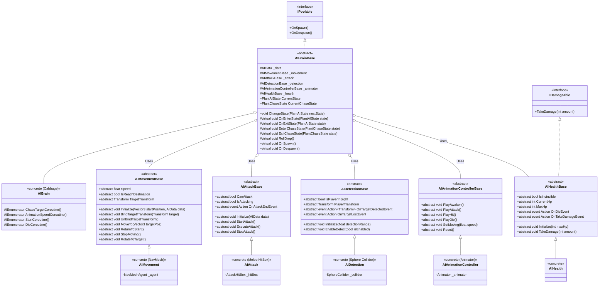

# Plant AI System Framework Refactoring — Technical Architecture Plan

## 1. System Overview & GameDesign Alignment
- **Feature Name**: Plant AI Modular Framework Refactoring
- **Target Subsystem**: Plant AI System (`Assets/Project/Scripts/AI/`)
- **GameOverview Reference**: Section 2 (The Living Harvest — Awakened crop monsters upon harvest), Section 3.2 (Combat & Equipment)
- **Problem Statement**:
  - Currently, `AIBrain.cs` is a monolithic coordinator tightly coupled to specific concrete classes (`AIMovement` with NavMesh, `AIAttack` with melee hitbox, `AIDetection`, `AIAnimationController`, `AIHealth`).
  - Creating new plant monster types with different locomotion (e.g. rooted turrets, hopping, burrowing) or different combat behaviors (e.g. ranged projectile spitting, area-of-effect spores) currently requires either duplicating/rewriting `AIBrain` or hacking concrete scripts.
- **Grill-Me Architectural Decisions**:
  1. **Architecture Paradigm**: Modular Component Strategy (Hybrid) — A coordinator base class (`AIBrainBase`) orchestrates abstract modular components (`AIMovementBase`, `AIAttackBase`, `AIDetectionBase`, etc.). Swapping movement or attack for new plants is done simply by attaching different MonoBehaviour components to the monster prefab. For plants with completely custom state lifecycles, developers can subclass `AIBrainBase`.
  2. **State Machine**: Virtual State Hooks — `AIBrainBase` manages core plant states (`Awake`, `Idle`, `Chase`, `Attack`, `Stun`, `Die`) with clean transition methods (`ChangeState`) and exposes protected virtual hooks (`OnEnterState`, `OnExitState`, `EnterChaseState`, `ExitChaseState`, coroutines) so derived brains can customize specific behaviors without rewriting the whole lifecycle.
  3. **Data Model**: Extensible `AIData` ScriptableObject — Base `AIData` retains standard stats (HP, Speed, Attack, Detection, Drops) to ensure 100% backward compatibility with existing assets, while allowing specialized data subclasses or component-level serialized overrides on prefabs.
  4. **Component Binding**: Abstract `MonoBehaviour` Base Classes serialized directly in the Inspector with `[SerializeField]` and auto-resolved via `GetComponent` fallback in `Awake()`.
  5. **Backward Compatibility**: Seamless In-Place Migration — Existing scripts (`AIBrain`, `AIMovement`, `AIAttack`, `AIDetection`, `AIAnimationController`, `AIHealth`) will inherit from their new abstract bases without changing GUIDs, ensuring existing Cabbage Monster prefabs (`Tier 1`, `Tier 2`, `Tier 3`, default, and test prefabs) remain fully functional.
  6. **Scope**: Core Framework First — Implement the base classes, refactor existing Cabbage components to inherit from them, verify zero prefab breakages, and add comprehensive developer documentation (`README.md`).

---

## 2. Architecture & Class Diagram



---

## 3. Data Models & ScriptableObjects
- **`AIData.cs`** remains the base ScriptableObject asset holding:
  - Movement: `Speed`, `Acceleration`, `TurnSpeed`, `StopDistance`, `DetectionRange`
  - Combat: `HP`, `Damage`, `AttackRange`, `AttackCooldown`, `StunTime`
  - Drop: `dropItem`, `dropAmountMin`, `dropAmountMax`, `dropChance`
- Existing ScriptableObjects continue to function without modification:
  - `Assets/Project/Data/Plant data/Cabbage/Cabbage AI Data Tier 1.asset`
  - `Assets/Project/Data/Plant data/Cabbage/Cabbage AI Data Tier 2.asset`
  - `Assets/Project/Data/Plant data/Cabbage/Cabbage AI Data Tier 3.asset`
  - `Assets/Project/Data/Plant data/Cabbage/Cabbage AI Data.asset`
  - `Assets/Project/Data/Plant data/Test AI.asset`
- Future plant types can either use `AIData` directly or subclass `AIData` (e.g. `RangedAIData : AIData`) to add projectile prefabs, burst counts, or unique attributes.

---

## 4. State Machine & Lifecycle Hooks
`AIBrainBase` standardizes the state machine lifecycle:
```csharp
public enum PlantAIState
{
    Awake,
    Idle,
    Chase,
    Attack,
    Stun,
    Die
}

public enum PlantChaseState
{
    ChasePlayer,
    ChaseHome
}
```

### Lifecycle & Virtual Hooks:
- `ChangeState(PlantAIState nextState)`: Guarded transition emitting state exit and entry hooks.
- `ChangeChaseState(PlantChaseState nextChaseState)`: Guarded chase sub-state transition.
- `OnEnterState(PlantAIState state)` / `OnExitState(PlantAIState state)`: Virtual methods for state entry/exit reactions.
- `OnTargetDetected(Transform target)`: Triggered when detection component spots the player.
- `OnTargetLost()`: Triggered when player exits detection range.
- `OnAttackEnd()`: Triggered when attack component finishes attack recovery/cooldown.
- `OnAttackAnimationHit()`: Animation event callback triggering `attack.ExecuteAttack()`.
- `OnTakeDamage()`: Triggered when health component takes damage (transitions to Stun).
- `OnDie()`: Triggered when health reaches 0 (transitions to Die).
- `OnSpawn()` / `OnDespawn()`: LeanPool lifecycle hooks.

---

## 5. Implementation Task Index

| Task ID | Task Title | Target Path | Dependencies |
| :--- | :--- | :--- | :--- |
| **Task 01** | Create Abstract Base Classes for AI Components | `Assets/Project/Scripts/AI/AIMovementBase.cs`<br>`Assets/Project/Scripts/AI/AIAttackBase.cs`<br>`Assets/Project/Scripts/AI/AIDetectionBase.cs`<br>`Assets/Project/Scripts/AI/AIAnimationControllerBase.cs`<br>`Assets/Project/Scripts/AI/AIHealthBase.cs` | None |
| **Task 02** | Create `AIBrainBase.cs` Coordinator | `Assets/Project/Scripts/AI/AIBrainBase.cs` | Task 01 |
| **Task 03** | Refactor Concrete AI Components to Inherit Base Classes | `Assets/Project/Scripts/AI/AIMovement.cs`<br>`Assets/Project/Scripts/AI/AIAttack.cs`<br>`Assets/Project/Scripts/AI/AIDetection.cs`<br>`Assets/Project/Scripts/AI/AIAnimationController.cs`<br>`Assets/Project/Scripts/AI/AIHealth.cs` | Task 01 |
| **Task 04** | Refactor `AIBrain.cs` to Inherit from `AIBrainBase` | `Assets/Project/Scripts/AI/AIBrain.cs` | Task 02, Task 03 |
| **Task 05** | Add Architecture Documentation (`README.md`) & Verify Prefabs | `Assets/Project/Scripts/AI/README.md`<br>`Assets/Project/Prefabs/Plant Monster/` | Task 04 |
