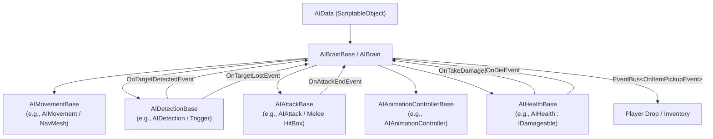

# Plant AI System Framework

## 1. Overview
The **Plant AI Framework** provides a modular, composition-first architecture for all plant monsters in **BanRaiValley** (built for Unity 6.3). 

Instead of monolithic "god-classes" where movement, combat, detection, animation, and health logic are tightly coupled, the system decouples each responsibility into abstract base contracts coordinated by a central brain. Any concrete plant monster can swap, extend, or replace individual components (e.g., swapping ground NavMesh pathfinding for a rooted turret or burrowing locomotion) without altering the brain or other components.

### Core Architecture Principles
- **Composition Over Inheritance**: Individual behaviors reside in dedicated components (`AIMovementBase`, `AIAttackBase`, `AIDetectionBase`, `AIAnimationControllerBase`, `AIHealthBase`).
- **Maximum Inheritance Depth $\le 2$**: `MonoBehaviour` $\rightarrow$ `BaseComponent` $\rightarrow$ `ConcreteComponent`.
- **Event-Driven & Zero Memory Leaks**: Component communication relies on explicit C# events with symmetric registration (`OnEnable`) and cleanup (`OnDisable`).
- **Object Pool Compatible**: Native integration with `LeanPool` via `IPoolable` on `AIBrainBase`.
- **Inspector & Prefab Stability**: Serialized fields on base classes preserve existing prefab links and support polymorphism.

---

## 2. Architecture & Component Diagram



---

## 3. Component Breakdown

| Base Class | Concrete Default | Role & Responsibilities |
| :--- | :--- | :--- |
| [`AIBrainBase`](file:///d:/Work/Unity%20Project/BanRaiValley/Assets/Project/Scripts/AI/AIBrainBase.cs) | [`AIBrain`](file:///d:/Work/Unity%20Project/BanRaiValley/Assets/Project/Scripts/AI/AI%20Brain.cs) | Central state machine (`PlantAIState`, `PlantChaseState`), lifecycle coordination, coroutine orchestration, event wiring, and drop rolls. |
| [`AIMovementBase`](file:///d:/Work/Unity%20Project/BanRaiValley/Assets/Project/Scripts/AI/AIMovementBase.cs) | [`AIMovement`](file:///d:/Work/Unity%20Project/BanRaiValley/Assets/Project/Scripts/AI/AI%20Movement.cs) | Locomotion, speed reporting, destination tracking, and horizontal orientation towards targets. |
| [`AIAttackBase`](file:///d:/Work/Unity%20Project/BanRaiValley/Assets/Project/Scripts/AI/AIAttackBase.cs) | [`AIAttack`](file:///d:/Work/Unity%20Project/BanRaiValley/Assets/Project/Scripts/AI/AI%20Attack.cs) | Attack execution, hitbox/projectile lifespan, and cooldown management. |
| [`AIDetectionBase`](file:///d:/Work/Unity%20Project/BanRaiValley/Assets/Project/Scripts/AI/AIDetectionBase.cs) | [`AIDetection`](file:///d:/Work/Unity%20Project/BanRaiValley/Assets/Project/Scripts/AI/AI%20Detection.cs) | Player sensing, line-of-sight/range checks, and target acquisition events. |
| [`AIAnimationControllerBase`](file:///d:/Work/Unity%20Project/BanRaiValley/Assets/Project/Scripts/AI/AIAnimationControllerBase.cs) | [`AIAnimationController`](file:///d:/Work/Unity%20Project/BanRaiValley/Assets/Project/Scripts/AI/AI%20Animation%20Controller.cs) | Skeletal animation trigger forwarding (`Awaken`, `Attack`, `Hit`, `Die`) and movement speed blend tree parameters. |
| [`AIHealthBase`](file:///d:/Work/Unity%20Project/BanRaiValley/Assets/Project/Scripts/AI/AIHealthBase.cs) | [`AIHealth`](file:///d:/Work/Unity%20Project/BanRaiValley/Assets/Project/Scripts/AI/AI%20Health.cs) | Hit point management, invincibility frames during awaken/cinematic states, and damage/death event dispatch. |
| [`AIData`](file:///d:/Work/Unity%20Project/BanRaiValley/Assets/Project/Scripts/AI/AI%20Data.cs) | — | ScriptableObject storing stats (Speed, HP, Damage, Ranges, StunTime, Drop item & chance). |

---

## 4. User Manual & Step-by-Step How-To Guides

### Guide 1: Creating a Monster with a New Movement Type (e.g., Rooted / Spore Turret)
When designing a plant monster that cannot walk (such as a stationary turret or carnivorous flower):
1. Create a new C# script inheriting from [`AIMovementBase`](file:///d:/Work/Unity%20Project/BanRaiValley/Assets/Project/Scripts/AI/AIMovementBase.cs):
   ```csharp
   public class AIRootedMovement : AIMovementBase
   {
       public override float Speed => 0f;
       public override bool IsReachDestination => true;
       public override Transform TargetTransform => _targetTransform;

       private Transform _targetTransform;

       public override void Initialize(Vector3 startPosition, AIData data) { }
       public override void BindTargetTransform(Transform target) => _targetTransform = target;
       public override void UnBindTargetTransform() => _targetTransform = null;
       public override void MoveTo(Vector3 targetPos) { /* Stationary: do nothing */ }
       public override void ReturnToStart() { }
       public override void StopMoving() { }
       public override void RotateToTarget()
       {
           if (_targetTransform == null) return;
           Vector3 dir = _targetTransform.position - transform.position;
           dir.y = 0f;
           if (dir.sqrMagnitude > 0.001f) transform.rotation = Quaternion.LookRotation(dir);
       }
   }
   ```
2. On your monster prefab, remove [`AIMovement`](file:///d:/Work/Unity%20Project/BanRaiValley/Assets/Project/Scripts/AI/AI%20Movement.cs) and attach `AIRootedMovement`.
3. In the Inspector for [`AIBrain`](file:///d:/Work/Unity%20Project/BanRaiValley/Assets/Project/Scripts/AI/AI%20Brain.cs), drag the `AIRootedMovement` component into the `Movement` slot (or leave it unassigned to let `Awake()` auto-wire it).

---

### Guide 2: Creating a Monster with a New Attack Type (e.g., Ranged Seed Spit)
When implementing a ranged attacker:
1. Create a new script inheriting from [`AIAttackBase`](file:///d:/Work/Unity%20Project/BanRaiValley/Assets/Project/Scripts/AI/AIAttackBase.cs):
   ```csharp
   public class AIRangedAttack : AIAttackBase
   {
       [SerializeField] private Transform _projectileSpawnPoint;
       [SerializeField] private GameObject _projectilePrefab;

       private bool _canAttack = true;
       private bool _isAttacking;
       private float _cooldown;
       private int _damage;

       public override bool CanAttack => _canAttack;
       public override bool IsAttacking => _isAttacking;
       public override event Action OnAttackEndEvent;

       public override void Initialize(AIData data)
       {
           _cooldown = data.AttackCooldown;
           _damage = data.Damage;
       }

       public override void StartAttack()
       {
           if (!_canAttack || _isAttacking) return;
           _canAttack = false;
           _isAttacking = true;
       }

       public override void ExecuteAttack()
       {
           // Spawn projectile from LeanPool or Instantiate
           // Projectile.Initialize(_damage);
           OnAttackEndEvent?.Invoke();
           StartCoroutine(CooldownRoutine());
       }

       public override void StopAttack()
       {
           StopAllCoroutines();
           _canAttack = true;
           _isAttacking = false;
       }

       private IEnumerator CooldownRoutine()
       {
           yield return new WaitForSeconds(_cooldown);
           _canAttack = true;
           _isAttacking = false;
       }
   }
   ```
2. Attach `AIRangedAttack` to the prefab and wire the `_projectileSpawnPoint`.
3. Assign it to the `Attack` reference on `AIBrain`.

---

### Guide 3: Creating a Monster with Unique States / Custom Brain
When a monster requires a brand-new behavior routine (e.g., burrowing underground when health drops below 50%):
1. Create a custom brain class inheriting from [`AIBrainBase`](file:///d:/Work/Unity%20Project/BanRaiValley/Assets/Project/Scripts/AI/AIBrainBase.cs):
   ```csharp
   public class BossPlantBrain : AIBrainBase
   {
       protected override void Initialize()
       {
           // Custom initialization
           detection.Initialize(data.DetectionRange);
           movement.Initialize(transform.position, data);
           attack.Initialize(data);
           health.Initialize(data.HP);
       }

       protected override void OnEnterState(PlantAIState state)
       {
           base.OnEnterState(state);
           // Add boss-specific stage triggers
       }
   }
   ```
2. Attach `BossPlantBrain` to the boss prefab.

---

### Guide 4: Creating New Monster Configuration Data
All monster base stats and drops are defined via ScriptableObjects:
1. In Unity's Project window, navigate to your desired data folder (e.g. `Assets/Project/Data/AI/`).
2. Right-click $\rightarrow$ **Create** $\rightarrow$ **Scriptable Objects** $\rightarrow$ **AIData**.
3. Name the asset (e.g. `PumpkinMonsterData.asset`).
4. In the Inspector, configure:
   - **Movement**: `Speed`, `Acceleration`, `TurnSpeed`, `StopDistance`, `DetectionRange`.
   - **Combat**: `HP`, `Damage`, `AttackRange`, `AttackCooldown`, `StunTime`.
   - **Drop**: Assign `Drop Item` (`Item` ScriptableObject), `Drop Amount Min`, `Drop Amount Max`, and `Drop Chance` (0.0 to 1.0).
5. Drag this `AIData` asset into the `Data` slot on your monster's `AIBrain` component.

---

### Guide 5: Assembling a Complete Plant Monster Prefab
1. Create a root GameObject in the scene (e.g. `SporeShroom Monster`).
2. Attach the required core components:
   - [`AIBrain`](file:///d:/Work/Unity%20Project/BanRaiValley/Assets/Project/Scripts/AI/AI%20Brain.cs) (or custom brain inheriting [`AIBrainBase`](file:///d:/Work/Unity%20Project/BanRaiValley/Assets/Project/Scripts/AI/AIBrainBase.cs))
   - An [`AIMovementBase`](file:///d:/Work/Unity%20Project/BanRaiValley/Assets/Project/Scripts/AI/AIMovementBase.cs) component (e.g. `AIMovement` with `NavMeshAgent`)
   - An [`AIDetectionBase`](file:///d:/Work/Unity%20Project/BanRaiValley/Assets/Project/Scripts/AI/AIDetectionBase.cs) component (e.g. `AIDetection` with `SphereCollider` as trigger)
   - An [`AIAttackBase`](file:///d:/Work/Unity%20Project/BanRaiValley/Assets/Project/Scripts/AI/AIAttackBase.cs) component (e.g. `AIAttack` with `AttackHitBox`)
   - An [`AIAnimationControllerBase`](file:///d:/Work/Unity%20Project/BanRaiValley/Assets/Project/Scripts/AI/AIAnimationControllerBase.cs) component (e.g. `AIAnimationController`)
   - An [`AIHealthBase`](file:///d:/Work/Unity%20Project/BanRaiValley/Assets/Project/Scripts/AI/AIHealthBase.cs) component (e.g. `AIHealth`)
3. Assign the `AIData` asset to `AIBrain`.
4. Drag the root GameObject into `Assets/Project/Prefabs/Plant Monster/` to save as a Prefab.
